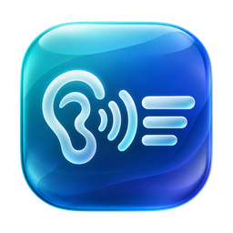
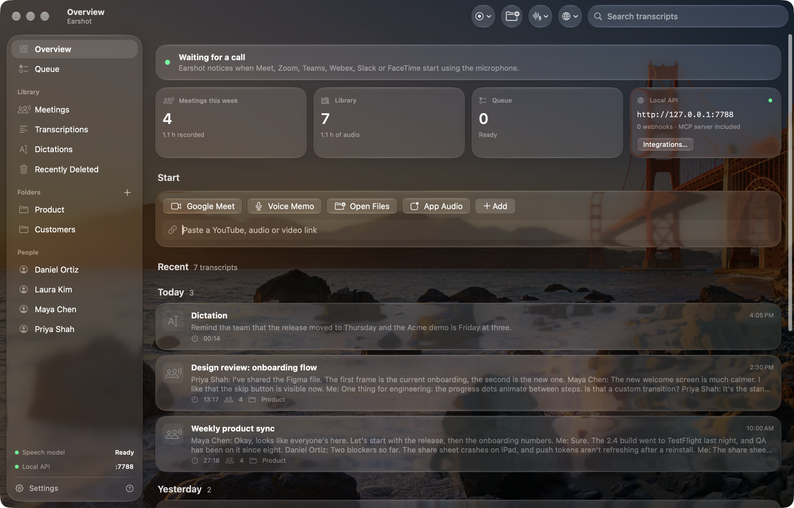
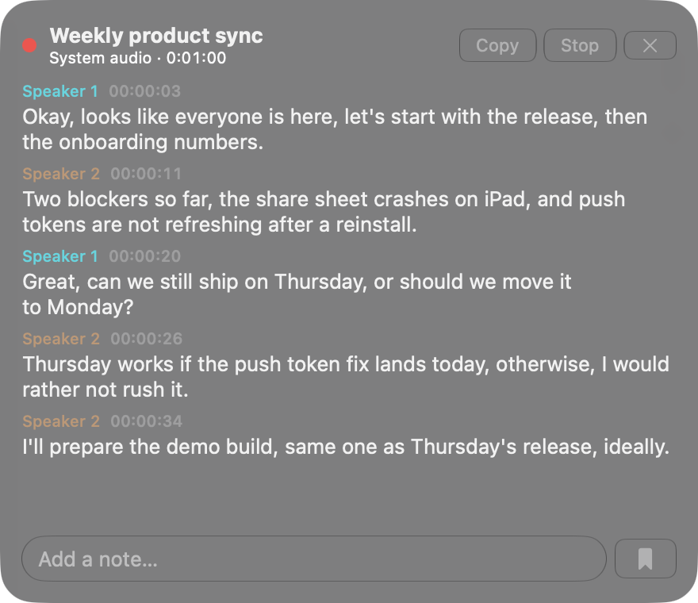
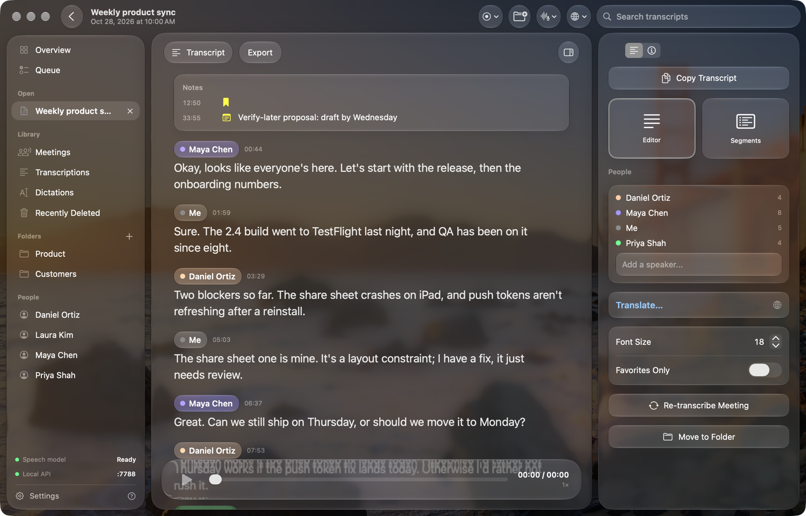
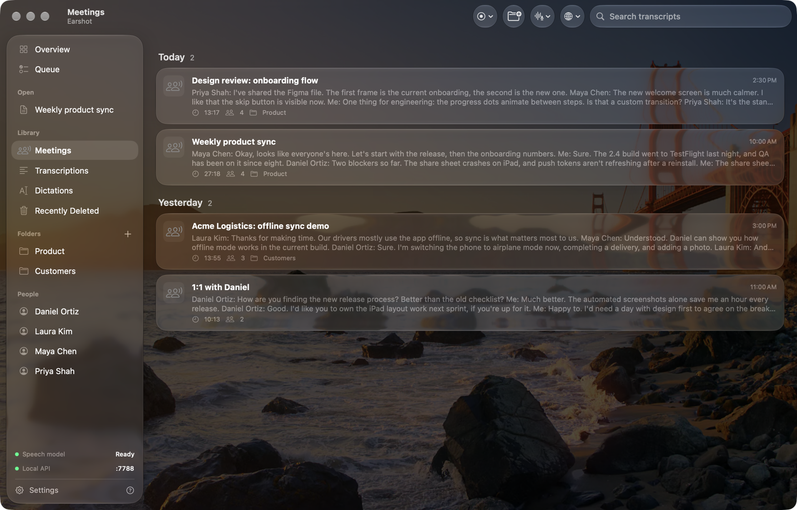
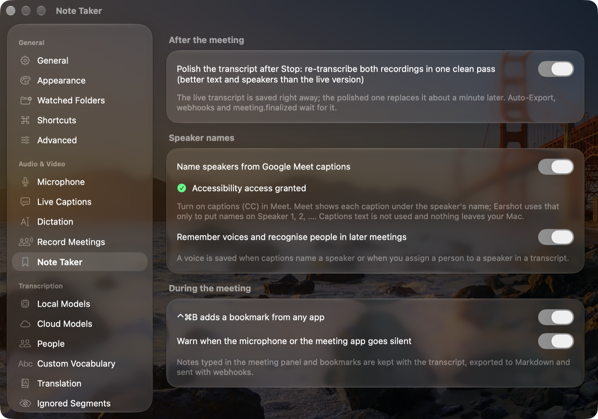

<p align="center"></p>

<h1 align="center">Earshot</h1>

**Private meeting transcripts for macOS.** Earshot notices when a call starts in Google Meet, Zoom, Teams, Webex,
Slack or FaceTime, records the meeting audio and your microphone, and transcribes both live, with speaker names,
in English and 98 other languages.
It all runs on your Mac: no bot joins the call and no audio leaves the machine. A local HTTP API, webhooks and an
MCP server let your other apps and agents use the transcripts.



<p align="center"><b><a href="https://github.com/vladt99/earshot/releases/latest/download/Earshot.zip">⬇ Download Earshot for macOS</a></b> · <a href="https://github.com/vladt99/earshot/releases">All releases</a></p>

## Features

- **Live meeting transcription.** Calls are detected from the macOS microphone indicator, so it works with any
  meeting app, including Google Meet in a browser. The other participants (the app's audio) and you (the mic) are
  captured as separate tracks, so you are always labelled correctly.
- **Speaker names.** Other participants are separated into Speaker 1, 2, … and, with captions on in Google Meet,
  named after the people in the call. Voices you name once are recognised in later meetings. Each speaker's turn is
  one paragraph, not a new line at every pause.
- **Knows the room (Google Meet).** Earshot reads Meet's page the way a screen reader does: the meeting title and
  link, who is in the call (guests and other notetaker bots marked), when people join, leave and present, chat
  messages, and the language of Meet's captions. That tells it how many speakers to look for, who said what, and
  which speech engine to use. The matching calendar event adds attendees and the agenda. All of it is saved with
  the meeting and shown in a Meeting tab with a clickable timeline.
- **Respects mute.** While you're muted in Meet, your microphone isn't recorded: Earshot writes silence instead, so
  side conversations never reach the transcript. When you leave the call, recording stops right away.
- **Two speech engines.** English runs on Parakeet, which is fast and light. Pick another language (Romanian,
  German, Spanish, …) and Earshot switches to Whisper large-v3-turbo with that language forced, which handles
  accents, names and mixed-in English far better.
- **Clean final transcript.** When the call ends, the live text is saved right away. Both recordings are then
  re-transcribed in one pass with full context: about a minute for an hour-long call in English, a few minutes with
  Whisper (silence is skipped, so muted stretches cost nothing).
- **Note taking.** Press ⌃⌘B from any app to bookmark a moment, or type notes in the live panel. They are saved on
  the transcript's timeline.
- **Custom vocabulary, plus the room's.** Teach it names and jargon ("Kubernetes", your colleagues' names) and it
  corrects them. In a meeting it also uses the participants' names and words from the calendar invite and chat as
  hints, and where it isn't sure of a name or term it takes the spelling Meet's captions show at that moment.
- **Reliable capture.** Echo cancellation keeps the other side out of your mic track on laptop speakers and turns
  itself off on headphones and AirPods. Capture follows you when you switch devices, including AirPods switching to
  call mode, falls back to all system audio if an app's own audio stays silent, warns you when an input goes
  silent, and a meeting interrupted by a crash, power loss or quitting is saved or recovered.
- **Storage that stays small.** Recordings are compressed to AAC once the transcript is done (about 8× smaller), and
  can be deleted automatically after 7, 30, 90 or 365 days while the transcripts stay.
- **Meeting series and people.** Recurring meetings are grouped with Previous / Next, links and emails from the chat
  are collected per meeting, and the API and MCP server answer "everything Maya said this month".
- **Everything else you'd expect:** file and watched-folder transcription (audio, video, YouTube links), voice memos,
  dictation, live captions, a full-text search, folders, people, export to TXT, SRT, VTT, Markdown and JSON, and
  auto-export to a folder, with Obsidian `[[links]]` for people and a line in your daily note if you want.
- **Updates itself** (with your permission) and has a Copy Diagnostics button for bug reports that leaves out names,
  titles and transcript text.
- **Built for automation:** an OpenAI-compatible local API, live Server-Sent Events, signed webhooks, an MCP server
  for Claude and other agents, and a URL scheme for Shortcuts, Raycast and Alfred.

| Live transcript | Transcript |
|---|---|
|  |  |

| Meetings | Settings |
|---|---|
|  |  |

## System requirements

| | |
|---|---|
| **macOS** | 26 Tahoe or later |
| **Mac** | Apple silicon (M1 or later). Intel Macs are not supported |
| **Memory** | 8 GB minimum, 16 GB recommended for long meetings |
| **Disk** | About 650 MB for the app and speech models, 1.6 GB more for languages other than English, plus about 230 MB per hour of recorded meeting |
| **Network** | To download the speech models from Hugging Face (≈ 525 MB on first launch, ≈ 1.6 GB more the first time you pick a language other than English) and, if you allow it, to check GitHub for updates |
| **Languages** | English and auto-detect: Parakeet TDT v3. Any other language: Whisper large-v3-turbo (99 languages), with the language you pick forced |
| **Speaker names from captions** | Google Meet in Chrome or another Chromium browser (Dia, Edge, Brave, Arc, Vivaldi), with captions (CC) on |

## Install

1. [**Download Earshot.zip**](https://github.com/vladt99/earshot/releases/latest/download/Earshot.zip) from the
   latest release.
2. Unzip it and drag **Earshot.app** to your **Applications** folder.
3. Open it. Earshot isn't notarized yet, so the first time macOS will say it can't verify the developer. Go to
   **System Settings → Privacy & Security**, scroll down and click **Open Anyway**. Or run this once in Terminal:

   ```sh
   xattr -dr com.apple.quarantine /Applications/Earshot.app
   ```

4. Grant the permissions when asked:

   | Permission | Why |
   |---|---|
   | Microphone | Your side of the call, dictation and voice memos |
   | Screen & System Audio Recording | The meeting app's audio (the other participants). Only audio is captured |
   | Accessibility *(optional)* | Reading Google Meet's captions to name speakers. Settings → Note Taker → Grant Access |
   | Calendar *(optional)* | Naming meetings after the current calendar event |
   | Notifications | "Meeting detected" alerts and finished transcripts |

5. Leave it running while the speech models download (≈ 525 MB, shown on the Overview). It then lives in the menu
   bar and asks you when a call starts. To record calls automatically, go to Settings → Record Meetings.

**Updates.** From 0.12 on, Earshot updates itself: on the second launch it asks whether to check for updates
automatically, and **Check for Updates…** is in the app menu, the menu bar panel and Settings → About. Updates are
signed (EdDSA) and come from this repository's releases. Coming from 0.11 or earlier, install 0.12 once by hand
(replace the app in Applications). Keep Earshot in Applications so the updater can replace it.

Releases are signed ad hoc, so macOS treats each version as a new app. After an update the Overview shows
**Earshot was updated — macOS needs your permission again** with a button for each pane: allow Microphone and
System Audio Recording again, and for Accessibility remove Earshot from **System Settings → Privacy & Security →
Accessibility** and add it again. Transcripts, settings and models are kept.

To uninstall, delete the app and, if you want to remove your data as well,
`~/Library/Application Support/Earshot` (transcripts and recordings) and
`~/Library/Application Support/FluidAudio/Models` (speech models; Whisper is inside the Earshot folder).

## Using it with Google Meet

1. Grant **Accessibility** once (Settings → Note Taker → Grant Access). Earshot needs it to read Meet's page: who is
   in the call, captions, mute state and the end screen.
2. Open the call in your browser (Chrome, Dia, Arc, Edge, Brave, Vivaldi). On Meet's **Ready to join?** screen
   Earshot shows **Before you join**: pick the language (Auto follows Meet's captions) and whether to record, show
   Live Captions or do nothing. It does that when you click Join, and remembers the choice for that meeting and its
   calendar series. Without that screen, Earshot shows **Meeting detected** once you're in: click **Transcribe**, or
   pick "Record automatically" in Settings → Record Meetings. **Live Captions** only shows text; during a call it's
   saved as a meeting too, unless you turn that off in Settings.
3. Captions (CC) give real names instead of Speaker 1, 2, …. Earshot turns them on for you once per call (they show
   only on your screen; turn that off in Settings → Record Meetings) and reminds you if they're off. It only uses the captions to
   see who is speaking, and their language to pick the engine (English → Parakeet, anything else → Whisper, which
   downloads once, 1.6 GB). The transcript text comes from its own model. A voice no caption named stays
   "Speaker 2"; Earshot then asks **Who is this?** with the people from the call who aren't named yet (in the panel
   once they've talked for a while, and above the saved transcript with a clip to play). The name sticks to that
   voice in later meetings. Picking the same name for two speakers merges them.
4. Use headphones or AirPods if you can. Echo cancellation helps on laptop speakers, but headphones give the
   cleanest audio.
5. Leave the call. Earshot stops as soon as Meet shows its end screen, saves the transcript and replaces it with
   the polished version shortly after.

macOS gives one audio stream for the whole browser, so a video playing in another tab of the same browser ends up
in the transcript. Run Meet in a different browser from the one you use for media.

## Models and storage

Nothing is bundled with the app. Each model downloads once from Hugging Face:

| Model | Used for | Size | When |
|---|---|---|---|
| [Parakeet TDT v3](https://huggingface.co/FluidInference/parakeet-tdt-0.6b-v3-coreml) | Transcription, live and files | 483 MB | First launch |
| [Pyannote Community-1](https://huggingface.co/FluidInference/speaker-diarization-coreml) | Telling speakers apart | 22 MB | First launch |
| LocalVQE v1.3 | Microphone echo cancellation | 20 MB | First launch |
| [Parakeet CTC 110M](https://huggingface.co/FluidInference/parakeet-ctc-110m-coreml) | Custom vocabulary (English) | 100 MB | When you add the first word |
| [Whisper large-v3-turbo](https://huggingface.co/argmaxinc/whisperkit-coreml) | Transcription in languages other than English | 1.6 GB | When you first pick another language |

The FluidAudio models live in `~/Library/Application Support/FluidAudio/Models/`, Whisper in
`~/Library/Application Support/Earshot/Models/whisperkit/`. Settings → Local Models shows them all and can delete or
re-download each one. Transcripts and recordings are in `~/Library/Application Support/Earshot/`. Each
meeting has its own folder with `others` (the other participants) and `me` (you): WAV while recording, compressed to
AAC (`.m4a`) once the final transcript is saved. Settings → Storage shows how much space recordings use, can keep
them for a limited time (transcripts and starred lines are never deleted), and can delete old ones now.

## Performance

Measured on a MacBook Pro with an M2 Max (8 performance + 4 efficiency cores) and 32 GB of RAM, with other apps
running as usual. Meetings were recorded with the microphone on and speaker labels on.

**English (Parakeet)**, Earshot 0.8.0, an 8.5-minute dialogue between two voices played through the speakers:

| Scenario | CPU average | CPU p95 | Memory average | Memory peak | Time |
|---|---|---|---|---|---|
| Idle in the menu bar | 0.6 % | 0 % | 121 MB | 121 MB | |
| Live meeting: app audio + microphone, live transcript, speaker labels | 85 % | 132 % | 421 MB | 818 MB | real time |
| Polishing the saved meeting (both tracks) | 125 % | | | 866 MB | 30 s |
| File transcription, with speaker labels | 118 % | 130 % | 385 MB | 810 MB | 20 s (26× real time) |
| File transcription, without speaker labels | 126 % | | | | 15 s (34× real time) |

**Romanian (Whisper large-v3-turbo)**, Earshot 0.9.0, 3 minutes of a real Romanian work call:

| Scenario | CPU average | CPU p95 | Memory average | Memory peak | Time |
|---|---|---|---|---|---|
| Idle in the menu bar, Whisper loaded | 0 % | 0 % | 1.7 GB | 1.7 GB | (0.12 unloads it after 10 idle minutes) |
| Live meeting: app audio + microphone, live transcript every ~2 s, speaker labels | 67 % | 85 % | 1.8 GB | 2.2 GB | real time |
| Polishing the saved 3-minute meeting | 60 % | | | 2.9 GB | 70 s |
| Polishing a saved 22-minute meeting | | | | | 7 min (0.9; see below) |
| File transcription, 5 minutes | | | | | 16 s (19× real time) |

Since 0.12 the Whisper final pass decodes only speech (muted and silent stretches are skipped), which cut a
22-minute meeting's Whisper time from about 6.5 to 1.5 minutes in testing. The tables will be re-measured on 0.12.

- CPU is a percentage of one core, as in Activity Monitor: 85 % is less than a tenth of this 12-core Mac.
- Parakeet runs mostly on the Neural Engine and Whisper's encoder on the GPU; these CPU figures don't include them.
- Whisper takes about 1.5 GB of memory while loaded. Since 0.12 it loads on Meet's pre-join screen and unloads after
  10 minutes without a meeting. With English, memory drops back to about 200 MB after a meeting.
- Recording uses about 220 MB of disk per hour while the meeting runs (two 16 kHz WAV tracks); once the transcript is
  done it's compressed to AAC, about 27 MB per hour.
- Live speaker labels are recomputed less often as a meeting grows, so long meetings don't slow the live transcript.
  Meetings of several hours haven't been measured yet.

Sampled every second with `top` for the Earshot process; CPU averages come from its total CPU time.

## Local API

Earshot serves an API on `http://127.0.0.1:7788` that is only reachable from your Mac. Every route except `/health`
needs `Authorization: Bearer <token>`. Apps find the token and URL in
`~/Library/Application Support/Earshot/api.json` (readable only by you; it exists only while the server is
listening). Requests carrying any `Origin` header, a `Sec-Fetch-Site` other than `none`, or a `Host` other than
loopback are refused, so web pages can't reach it. Bodies are limited to 1 MB, except the three upload routes
(1 GiB); the server allows 32 connections and 16 event streams at a time. To change the port, run
`defaults write io.github.vladt99.Earshot port -int 9000`.

```sh
TOKEN=$(jq -r .token ~/Library/Application\ Support/Earshot/api.json)

# Transcribe a file (OpenAI-compatible)
curl -s localhost:7788/v1/audio/transcriptions -H "Authorization: Bearer $TOKEN" -F file=@memo.m4a

# A local file by path, as subtitles, with speakers
curl -s localhost:7788/v1/audio/transcriptions -H "Authorization: Bearer $TOKEN" \
     -d '{"path":"~/Movies/call.mp4","response_format":"srt","diarize":true}'

# Follow a meeting live
curl -sN "localhost:7788/v1/events?filter=meeting." -H "Authorization: Bearer $TOKEN"
```

The OpenAI SDKs work with `base_url="http://127.0.0.1:7788/v1"` and the token as the API key.

### Transcription

| Method & path | What |
|---|---|
| `GET /health` | `{ok, version, loaded_model}`, the only route without auth |
| `GET /v1/status` | Engine state, model, downloads, active jobs, dictation |
| `POST /v1/audio/transcriptions` | OpenAI-compatible. Multipart `file` + `model`, `language`, `response_format` (`json`, `text`, `srt`, `vtt`, `verbose_json`), or JSON `{"path": "/abs/file"}` for local files. Extras: `save` (default true), `title`, `translate`, `diarize`. Synchronous |
| `POST /v1/audio/translations` | Same, translated to English on-device (Apple Translation) |
| `POST /v1/jobs` · `GET /v1/jobs` · `GET /v1/jobs/{id}[?wait=true]` | Asynchronous version; the transcript is included once the job is `done` |
| `POST /v1/import/url` `{"url"}` | YouTube page (needs `brew install yt-dlp`) or direct media URL, up to 4 GB → job |

### Library

| Method & path | What |
|---|---|
| `GET /v1/transcripts?limit=&offset=&q=&origin=` | History; `origin` is one of `meeting`, `dictation`, `voicememo`, `api`, `app`, `watch`, `youtube`, `appaudio`, `podcast` |
| `GET /v1/transcripts/{id}?format=` | One transcript in any format |
| `POST /v1/transcripts/{id}/translate` `{"target": "de"}` | On-device translation |
| `DELETE /v1/transcripts/{id}[?permanent=true]` | Move to Recently Deleted, or delete for good |
| `GET /v1/search?q=&limit=&origin=` | Full-text search; each hit has a `snippet` and the matching lines with speaker and time |
| `POST /v1/transcripts/{id}/speakers` `{"from": "Speaker 1", "to": "Maya"}` | Rename a speaker; for meetings this also remembers Maya's voice. A name another speaker already has merges the two |
| `GET /v1/voices` · `DELETE /v1/voices/{name}` | Remembered voices |

### Meetings and live events

| Method & path | What |
|---|---|
| `GET /v1/events[?filter=meeting.,job.]` | Server-Sent Events: `meeting.detected`, `meeting.prejoin`, `meeting.started`, `meeting.partial`, `meeting.segment`, `meeting.speakers_revised`, `meeting.note`, `meeting.warning`, `meeting.capture_restarted`, `meeting.ended_detected`, `meeting.resumed_after_sleep`, `meeting.saved`, `meeting.polishing`, `meeting.finalized`, `meeting.retranscribed`, `meeting.recovered`, `meeting.kept`, `meeting.speaker_named`, `meeting.mic_muted`, `meeting.mic_unmuted`, `audio.tap_fallback`, `audio.echo_cancellation_bypassed`, `job.done`, `job.failed`. `filter` takes prefixes (`meeting.`) or `*` |
| `GET /v1/meetings/current[?format=text]` | The running meeting's live transcript, notes, warnings, `context`, `self_muted`, `live_captions` and `saved` |
| `POST /v1/meetings/current/keep` | Save the running Live Captions as a meeting |
| `POST /v1/meetings/current/notes` `{"text"}` · `POST /v1/meetings/current/bookmark` | Add a note or bookmark now |
| `GET /v1/meetings/detected` | The app currently detected as being in a call |
| `POST /v1/meetings/start` `{"app"?: bundle id or "system", "title"?, "mic"?: true}` | Start recording (defaults to the detected app) |
| `POST /v1/meetings/stop` | Stop and save. Returns the live transcript; `polishing` says whether a final version follows as `meeting.finalized` |
| `GET /v1/meetings` | Saved meetings, with `participants`, `meeting_code`, `meeting_url` and `platform` |
| `POST /v1/meetings/{id}/retranscribe` | Re-transcribe both recordings at full quality (409 when the recording was deleted) |
| `GET /v1/meetings?series=` | Meetings of one series (a `series_id` from the list, a calendar series id or a title) |
| `GET /v1/speakers` | Every named speaker with meeting count, line count and last seen |
| `GET /v1/speakers/{name}/lines?limit=&since=&q=` | One person's lines across all meetings, newest first; matches names case- and accent-insensitively, and first names or emails through the participant list |
| `GET /v1/diagnostics` | The same plain-text report as Settings → About → Copy Diagnostics |

### Models, settings, dictation

| Method & path | What |
|---|---|
| `GET /v1/models` | Every model with `installed`, `bytes_on_disk`, `download_bytes`, `path` |
| `POST /v1/models/download` `{"model"}` · `DELETE /v1/models/{id}` | Download or remove `parakeet-tdt-v3`, `whisper-large-v3-turbo`, `speaker-diarization`, `localvqe`, `parakeet-ctc-110m` |
| `GET` / `PATCH /v1/settings` | `meeting_mode` (`ask`, `auto`, `off`), `meeting_apps`, `auto_stop_after_meeting`, `auto_dismiss_meeting_alerts`, `prejoin_overlay`, `diarize_meetings`, `diarize_files`, `participants_name`, `my_name`, `echo_cancellation`, `language`, `watched_folders`, `polish_after_meeting`, `auto_name_speakers`, `remember_voices`, `vocabulary`, `bookmark_hotkey`, `audio_warnings`, `webhooks`, `webhook_events`, `auto_export_folder`, `auto_export_formats`, `follow_meeting_language`, `respect_mute`, `keep_live_captions_of_calls`, `txt_header`, `auto_enable_captions`, `meet_health_warnings`, `room_vocabulary`, `caption_spelling`, `compress_recordings`, `keep_audio_days` (0 = forever), `obsidian_links`, `obsidian_daily_note` |
| `POST /v1/recordings/cleanup` | Delete the recordings older than `keep_audio_days` now (setting it only takes effect at the next daily run). Returns `deleted` and `bytes_freed` |
| `GET /v1/dictation` · `POST /v1/dictation/start` · `stop` · `cancel` | Microphone dictation; `stop` returns the transcript |

A saved meeting's verbose JSON (and its webhooks) carries a `context` object: `platform`, `meeting_code`, `url`,
`title`, `calendar` (event, organizer, notes, attendees), `caption_language`, `participants` (`name`, `email`,
`external`, `bot`, `is_self`, `presentation`, `joined_at`, `left_at`), `events` (`t`, `kind`, `who`, `text`) and
`self_muted` intervals. The `text` field has one paragraph per speaker turn, separated by blank lines.

`language` takes an ISO 639-1 code or `auto`; anything other than `en` or `auto` is transcribed with Whisper. The
OpenAI `model` field can force an engine (`parakeet-tdt-v3` or `whisper-large-v3-turbo`); other values are
ignored. Errors use OpenAI's shape: `{"error": {"message", "code"}}`.

### Webhooks

Settings → Integrations takes a list of URLs and the events to send (by default `meeting.finalized` and `job.done`,
both of which include the full transcript; prefixes like `meeting.` and `*` work too). Each POST carries
`X-Earshot-Event` and `X-Earshot-Signature: sha256=<HMAC-SHA256 of the body>`, keyed with the webhook secret shown
in Settings → Integrations (separate from the API token, and rotatable). The body always includes `event` and `ts`,
so receivers can reject replays. Failed deliveries are retried twice.

### MCP server

The app bundle includes an MCP server that lets Claude and other agents search and read your meetings:

```sh
claude mcp add earshot -- /Applications/Earshot.app/Contents/MacOS/earshot-mcp
```

Transcripts come with the room and participant list, so "what did the guest from Acme ask?" works. Tools:
`search_transcripts`, `list_meetings` (optionally one `series`), `get_transcript`, `speaker_lines`, `list_speakers`,
`current_meeting`, `start_meeting`, `stop_meeting`, `add_meeting_note`, `transcribe_file`. Earshot must be running.

### URL scheme

`earshot://meeting/start[?app=com.google.Chrome|system&title=…&mic=false]` · `meeting/stop` · `meeting/toggle` ·
`dictation/toggle` · `transcribe?path=/abs/file` · `open?id=<transcript id>` · `show?page=meetings` ·
`settings?page=Record%20Meetings` · `panel`

Links that start a recording, dictation or a transcription ask you to confirm first, so a web page can't start one
by itself. Watched folders save results next to each file as `name.earshot.txt` and `name.earshot.srt`, and files
added while Earshot was closed are picked up at the next launch.

## Build from source

You need macOS 26, Apple silicon and Xcode 26 or later (Swift 6.2). Xcode's `actool` compiles the app icon; without
it the build falls back to a plain `.icns`.

```sh
git clone https://github.com/vladt99/earshot.git
cd earshot
./build.sh            # release build → dist/Earshot.app
./build.sh --open     # build and launch
./build.sh --install  # build, copy to /Applications and launch
./build.sh --zip      # build and pack dist/Earshot.zip for a release
```

Builds are signed ad hoc, so macOS asks for permissions again after every rebuild. To keep them, sign with a stable
identity: create a `.signing.env` (git-ignored) with `SIGN_IDENTITY="Your Certificate Name"`, plus `SIGN_KEYCHAIN`
and `SIGN_KEYCHAIN_PASSWORD_FILE` if the certificate is in its own keychain.

Tests cover the pure logic (Meet page parsing, pre-join, speaker pipeline, caption spelling, formats, diagnostics
redaction) and need no models or devices: `swift test`.

To publish a release: bump `CFBundleShortVersionString` and `CFBundleVersion` in Info.plist, commit, then run
`scripts/release.sh <version>`. It builds the zip, signs it for Sparkle with the EdDSA key in your login keychain
(account `earshot`), updates `appcast.xml`, and prints the remaining steps. It refuses a dirty tree, a build number
that didn't go up, and a version that's already released. Back up the key once with
`generate_keys --account earshot -x <file>` (Sparkle's tool, under `.build/artifacts`) and keep the file outside the
repo: without it, existing installs can't be updated.

For debugging live transcription, run `defaults write io.github.vladt99.Earshot liveDebug -bool true`; the log is
written to `~/Library/Application Support/Earshot/live-debug.log`.

### Source layout

```
Sources/Earshot/
  App.swift              scenes: main window, Settings, menu bar
  AppState.swift         observable app state, navigation, library actions
  UI/Theme.swift         backdrop, glass cards, shared components
  UI/MainWindow.swift    sidebar, toolbar, routing
  UI/HomeView.swift      overview, quick start, App Audio picker, Batch Export
  UI/LibraryViews.swift  transcript lists, Recently Deleted, Queue
  UI/DetailView.swift    transcript editor and segments, inspector, playback
  UI/SettingsWindow.swift  settings pages
  Views.swift            menu bar panel
  MeetingPanel.swift     floating live transcript, notifications
  MeetingDetector.swift  call detection, calendar titles
  Meeting.swift          meeting sessions, live transcription, live speakers, notes, watchdog, final pass
  Notetaker.swift        crash recovery, speaker naming (captions, voices), bookmark hotkey
  MeetObserver.swift     Google Meet through the accessibility tree: room, people, captions, mute, chat, end
  PreJoin.swift          "Before you join" overlay on Meet's green room, remembered choices
  SpeakerPicker.swift    "Who is this?" candidates and clips for unnamed voices
  CaptionSpelling.swift  room vocabulary, spelling names from captions, vocabulary safety checks
  MeetingAudio.swift     meeting tracks (WAV/AAC), compression
  AudioRetention.swift   deleting old recordings
  Series.swift, SpeakerLines.swift, Diagnostics.swift, Updater.swift
  MeetingContext.swift   the meeting context saved with each meeting
  UI/MeetingInfo.swift   Meeting tab: room, calendar, participants, timeline
  AudioCapture.swift     Core Audio process tap, ring buffer, gap filling, microphone
  Engine.swift           engine routing; FluidAudio: Parakeet, diarization, custom vocabulary
  Whisper.swift          WhisperKit: Whisper large-v3-turbo, hallucination guard
  Jobs.swift             transcription queue
  Dictation.swift        dictation and voice memos
  Store.swift            SQLite library with FTS5 search
  PostProcess.swift      ignored segments, find & replace, auto-export
  Extras.swift           watched folders, URL import, translation, URL scheme
  Webhooks.swift         signed event delivery
  HTTPServer.swift, API.swift, Events.swift, Formats.swift, Models.swift, Settings.swift
Sources/EarshotMCP/main.swift   MCP server (stdio) over the local API
Tests/EarshotTests/             unit tests (swift test)
```

## How it works

- **Call detection.** Earshot follows Control Center's microphone-in-use attributions from the system log. When a
  known meeting app (or a browser) holds the microphone, that's a call. A call only counts as ended after the app
  has released the mic for 4 seconds. There is no polling and no reading of browser URLs.
- **Capture.** The meeting app's output is captured with a Core Audio process tap on a private aggregate device,
  including helper processes (Chrome renderers, Teams helpers, Safari's WebKit GPU process). The microphone is
  recorded separately and passed through LocalVQE echo cancellation, with everything the Mac plays as the
  reference, aligned by timestamps (skipped on headphones). Both tracks are kept on one clock, and the real sample
  rate of each device is followed, including AirPods dropping to 24 kHz in call mode.
- **Live transcription.** Each track has its own streaming transcriber: Parakeet runs on voice activity, and text is
  confirmed once consecutive passes agree on it. With Whisper, a pass runs about every 2 seconds over the last 20
  seconds, and silence, repetition loops and the usual "thanks for watching" hallucinations are dropped. Speakers on the app track come from pyannote, re-run as the
  recording grows.
- **Meeting context.** For Google Meet, Earshot reads the call page through the accessibility tree (no extension, no
  network): participants, captions with speaker names, mute states, presenting, chat and the end screen. The roster
  bounds how many voices the diarizer may find; caption turns, shifted by their measured lag, name each voice; a
  participant who is muted can't be the one talking.
- **Final pass.** After the call, both recordings are transcribed in full. Short speaker flips are smoothed out,
  each sentence goes to one speaker, near-identical voices are merged, and speakers are named from Meet captions,
  then remembered voices. Custom vocabulary is applied.

## Status and known limitations

Earshot is young (0.12). What has been tested and what hasn't:

- Tested: call detection, live and final transcription in English and Romanian, AirPods in call mode, speaker
  separation, naming speakers from Meet captions on a recorded 40-minute call (96 % agreement with Meet's own
  captions), remembered voices, bookmarks and notes, crash recovery, search, export, webhooks, the API and the MCP
  server.
- Tested in a live 14-minute Romanian Meet call in Dia on AirPods (0.11): the Before you join screen, all 8 speakers
  named from captions, the mic blanked while muted, the engine following Meet's caption language, live Whisper, and
  stopping at Meet's end screen.
- Not yet tested in a live call: turning captions on automatically, the Meet health warning, room vocabulary and
  caption spelling live, naming a voice from the live panel, updating through Sparkle, FaceTime, switching audio
  devices mid-call and the silent-input warnings. Reports are welcome.
- Meet support depends on Meet's page labels, which Google can change. English is verified; other Meet interface
  languages are best guesses.
- Only people who get captions can be named; others stay Speaker N until you name them once (Who is this?).
- Live speaker labels can change during the first minute while the model learns the voices. The final pass is more
  accurate.
- On laptop speakers without headphones, some of the other side can still reach your microphone track.
- macOS gives one audio stream per browser, so other tabs playing sound end up in the meeting recording.
- The app isn't notarized yet, so macOS needs one manual confirmation on first launch.

## Privacy

Audio, transcripts and voice profiles stay on your Mac. Earshot connects to the internet only to download models
from Hugging Face, to fetch a YouTube link you paste, to send webhooks you configure yourself, and (if you allow it)
to check this repository for updates. The API only listens on 127.0.0.1. Copy Diagnostics never includes names,
meeting titles, codes, device names or transcript text.

## Credits

- [FluidAudio](https://github.com/FluidInference/FluidAudio) (Apache 2.0) for on-device speech recognition,
  diarization and echo cancellation on Core ML
- [NVIDIA Parakeet TDT v3](https://huggingface.co/nvidia/parakeet-tdt-0.6b-v3) (CC BY 4.0)
- [WhisperKit](https://github.com/argmaxinc/WhisperKit) (MIT) and [OpenAI Whisper large-v3-turbo](https://huggingface.co/openai/whisper-large-v3-turbo) (MIT)
- [pyannote](https://github.com/pyannote/pyannote-audio) speaker diarization (MIT)
- [Sparkle](https://sparkle-project.org) (MIT) for updates

## License

Public domain ([Unlicense](LICENSE)). Do anything you like with it: use, copy, modify, sell, no attribution needed.
The speech models, FluidAudio, WhisperKit and Sparkle keep their own licences (listed under Credits).
